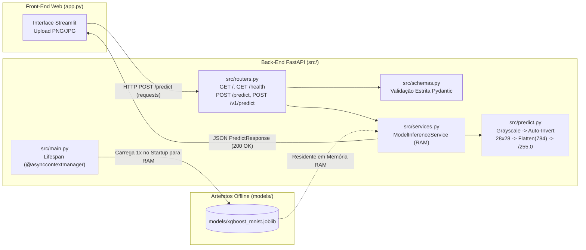

# 🔢 Classificação de Dígitos Manuscritos (MNIST) com XGBoost, FastAPI e Streamlit

> **Projeto Avaliativo Final — Desenvolvimento de IA para Análise Preditiva [T1 e T2] (SCTEC)**  
> **Módulo 2 — Semana 13**  
> **Autor:** Fábio Rodrigues Spiazzi

---

## 📋 Sumário

1. [Nome e Resumo do Projeto (Problema de Negócio)](#1-nome-e-resumo-do-projeto-problema-de-negócio)
2. [Origem do Modelo e Relatório de Métricas (Fase 1)](#2-origem-do-modelo-e-relatório-de-métricas-fase-1)
3. [Arquitetura do Sistema e Fases Técnicas (Fases 2, 3, 4 e 5)](#3-arquitetura-do-sistema-e-fases-técnicas-fases-2-3-4-e-5)
4. [Tecnologias Utilizadas](#4-tecnologias-utilizadas)
5. [Instruções Passo a Passo de Instalação e Execução](#5-instruções-passo-a-passo-de-instalação-e-execução)
6. [Documentação da API RESTful e Exemplos de Payloads](#6-documentação-da-api-restful-e-exemplos-de-payloads)
7. [Orientações para Versionamento no GitHub (GitFlow)](#7-orientações-para-versionamento-no-github-gitflow)
8. [Links das Evidências (Vídeo e Repositório)](#8-links-das-evidências-vídeo-e-repositório)

---

## 1. Nome e Resumo do Projeto (Problema de Negócio)

**Nome do Projeto:** Microsserviço Preditivo para Reconhecimento Óptico de Dígitos Manuscritos (MNIST) com XGBoost e FastAPI.

**Problema de Negócio que Resolve:**  
Na automação bancária (leitura de cheques e envelopes), triagem postal (reconhecimento automático de CEPs manuscritos) e digitalização de formulários cadastrais, a leitura manual de algarismos escritos à mão gera gargalos operacionais, custos elevados e falhas humanas. Embora modelos preditivos atinjam alta precisão em ambientes experimentais (Jupyter Notebooks), o verdadeiro valor de negócio só é alcançado quando o modelo é empacotado segundo práticas modernas de **MLOps** e disponibilizado em produção como um **microsserviço escalável, integrável, validado em tempo de execução e de baixa latência**.

Este projeto resolve esse desafio ponta a ponta através de uma **arquitetura de microsserviços desacoplada**:
1. **Pipeline Offline (`src/train.py` e `models/`):** Treinamento, validação, teste e serialização do modelo campeão **XGBoost Classifier** (`models/xgboost_mnist.joblib`).
2. **Pipeline de Visão Computacional (`src/predict.py`):** Tratamento automático de imagens enviadas por usuários (conversão para escala de cinza, detecção e inversão automática de fundo claro para o padrão MNIST de fundo preto e traço branco, redimensionamento para `28x28`, achatamento em vetor de `784` características e normalização por `255.0`).
3. **Back-End RESTful Assíncrono (`src/main.py`, `src/routers.py`, `src/services.py`, `src/schemas.py`):** API construída com **FastAPI**, carregamento único em memória RAM via `@asynccontextmanager` (`lifespan`) e validação estrita de contratos de entrada/saída com **Pydantic**.
4. **Front-End Cliente Web (`app.py`):** Aplicação **Streamlit** atuando estritamente como cliente HTTP (`requests.post` para `http://127.0.0.1:8000/predict`), permitindo upload de imagens PNG/JPG e visualização interativa da predição e probabilidades.

---

## 2. Origem do Modelo e Relatório de Métricas (Fase 1)

### Origem do Modelo (Opção A)
Este projeto adota a **Opção A** das diretrizes avaliativas da SCTEC: **reaproveitamento e refinamento do modelo campeão desenvolvido no Mini-Projeto 2** (*Pipeline Preditivo Multiclasse ponta a ponta para classificação de dígitos manuscritos a partir do dataset MNIST `mnist_784`*).

No estudo comparativo realizado no Mini-Projeto 2 (`MiniProjeto_2_SCTEC_Fábio_R_Spiazzi.ipynb`), três arquiteturas distintas foram submetidas à busca de hiperparâmetros (`GridSearchCV` / `KerasTuner`) e avaliadas no conjunto de teste:

| Modelo Avaliado | Acurácia (Teste) | Precisão (Weighted Avg) | Recall (Weighted Avg) | F1-Score (Weighted Avg) | Status |
| :--- | :---: | :---: | :---: | :---: | :---: |
| **XGBoost Classifier** | **97,60% (0.9760)** | **0.9760** | **0.9760** | **0.9760** | 🏆 **Modelo Campeão Selecionado** |
| **MLP (Rede Neural Densa)** | 97,53% (0.9753) | 0.9755 | 0.9753 | 0.9753 | 2º Lugar |
| **Random Forest Classifier** | 96,81% (0.9681) | 0.9681 | 0.9681 | 0.9681 | 3º Lugar |

### Tratamento do Pipeline Offline e Hiperparâmetros Otimizados (`src/train.py`)
- **Base de Dados:** `mnist_784` (OpenML v1), composta por **70.000 imagens** de dígitos manuscritos (`0` a `9`) em resolução `28x28` pixels (784 features).
- **Prevenção de Vazamento de Dados (*Data Leakage*):** Divisão estratificada em **Treino (70% — 49.000 amostras)**, **Validação (10% — 7.000 amostras)** e **Teste (20% — 14.000 amostras)** executada antes do pré-processamento, seguida por verificação/imputação de nulos, codificação inteira de rótulos e escalonamento dos pixels para `[0.0, 1.0]` dividindo por `255.0`.
- **Hiperparâmetros Campeões do XGBoost:**
  - `n_estimators = 200`
  - `max_depth = 7`
  - `learning_rate = 0.1`
  - `subsample = 0.9`
  - `colsample_bytree = 0.7`
  - `tree_method = "hist"` e `eval_metric = "mlogloss"`
- **Artefatos Gerados:**
  - Modelo serializado: `models/xgboost_mnist.joblib`
  - Relatório JSON de métricas e matriz de confusão: `models/metrics_report.json`

---

## 3. Arquitetura do Sistema e Fases Técnicas (Fases 2, 3, 4 e 5)



### Estrutura de Diretórios do Projeto

```text
Projeto Final/
├── data/
│   └── samples/                        # Imagens reais PNG/JPG para teste (fundo escuro e fundo claro)
├── models/
│   ├── xgboost_mnist.joblib            # Artefato binário serializado do modelo XGBoost Campeão
│   ├── metrics_report.json             # Relatório de métricas (Acurácia, F1-Score, ROC-AUC, Matriz de Confusão)
│   └── README.md
├── src/
│   ├── __init__.py                     # Inicializador do pacote Python
│   ├── main.py                         # Fase 2 & 3: Entrada da API FastAPI e Lifespan (@asynccontextmanager)
│   ├── routers.py                      # Fase 2 & 5: Rotas APIRouter (/, /health, /predict, /v1/predict)
│   ├── schemas.py                      # Fase 2 & 4: Contratos Pydantic (BaseModel, Field, validações 422)
│   ├── services.py                     # Fase 2 & 3: Camada de serviço mantendo o modelo em memória RAM
│   ├── predict.py                      # Requisito 1: Pré-processamento OpenCV/PIL (28x28, inversão, 784, /255.0)
│   └── train.py                        # Fase 1: Script do Pipeline Offline de treinamento e serialização
├── app.py                              # Fase Front-End: Cliente Web em Streamlit consumindo a FastAPI via requests
├── MiniProjeto_2_SCTEC_Fábio_R_Spiazzi.ipynb # Notebook original de experimentação e seleção de modelos
├── requirements.txt                    # Dependências e versões para reprodutibilidade
├── .gitignore                          # Regras de exclusão para versionamento limpo no Git
└── README.md                           # Documentação técnica completa do projeto
```

---

## 4. Tecnologias Utilizadas

| Biblioteca / Ferramenta | Versão Mínima Recomendada | Finalidade no Projeto |
| :--- | :---: | :--- |
| **Python** | `3.10+` | Linguagem base do pipeline de Ciência de Dados e Microsserviços |
| **FastAPI** | `>= 0.115.0` | Framework web assíncrono para construção da API RESTful |
| **Uvicorn** | `>= 0.30.0` | Servidor ASGI de alta performance para execução do FastAPI |
| **Pydantic** | `>= 2.9.0` | Modelagem e validação estrita de esquemas de dados (`BaseModel`, `Field`) |
| **XGBoost** | `>= 2.1.0` | Algoritmo de Gradient Boosting campeão na classificação do MNIST |
| **Scikit-Learn** | `>= 1.5.0` | Divisão estratificada de dados, métricas de validação e acesso ao OpenML |
| **OpenCV (`opencv-python-headless`)** | `>= 4.10.0.84` | Processamento matricial de imagens, redimensionamento e centralização `28x28` |
| **Pillow (`PIL`)** | `>= 10.4.0` | Leitura e conversão de imagens enviadas via upload (`PNG`/`JPG`) |
| **NumPy** | `>= 2.0.0` | Vetorização em 784 posições e normalização matemática (`/ 255.0`) |
| **Joblib** | `>= 1.4.0` | Serialização e desserialização otimizada do artefato `.joblib` |
| **Streamlit** | `>= 1.39.0` | Construção da interface gráfica Front-End cliente |
| **Requests** | `>= 2.32.0` | Comunicação HTTP (`GET` e `POST`) entre o Front-End Streamlit e a FastAPI |

---

## 5. Instruções Passo a Passo de Instalação e Execução

Abra o terminal (**PowerShell** ou **Prompt de Comando**) na pasta raiz do projeto:

```powershell
cd "D:\Curso SCTech\Projeto Final"
```

### Passo 1: Criar e Ativar o Ambiente Virtual (`venv`)

```powershell
# Criação do ambiente virtual isolado
python -m venv venv

# Ativação no Windows (PowerShell)
.\venv\Scripts\Activate.ps1

# (Alternativa no Windows CMD)
# venv\Scripts\activate.bat

# (Alternativa no Linux/macOS)
# source venv/bin/activate
```

### Passo 2: Instalar as Dependências (`requirements.txt`)

```powershell
pip install --upgrade pip
pip install -r requirements.txt
```

### Passo 3: Executar o Pipeline Offline de Treinamento (Caso deseje gerar/atualizar o modelo)

> O projeto já acompanha o modelo treinado em `models/xgboost_mnist.joblib`. Caso queira executar o treinamento completo do zero e exportar as métricas e imagens de amostra:

```powershell
python -m src.train
```

### Passo 4: Iniciar o Servidor Back-End FastAPI (Terminal 1)

Com o ambiente virtual ativo na raiz do projeto, execute o servidor Uvicorn:

```powershell
uvicorn src.main:app --reload --host 127.0.0.1 --port 8000
```

- A API estará disponível em: **`http://127.0.0.1:8000`**
- Documentação interativa **Swagger UI**: **`http://127.0.0.1:8000/docs`**
- Documentação **ReDoc**: **`http://127.0.0.1:8000/redoc`**

### Passo 5: Iniciar o Front-End Cliente Streamlit (Terminal 2)

Abra um **segundo terminal**, ative o mesmo ambiente virtual (`.\venv\Scripts\Activate.ps1`) e inicie o cliente Streamlit:

```powershell
streamlit run app.py
```

- O navegador abrirá automaticamente em **`http://localhost:8501`**.
- Faça upload de uma imagem (`.png` ou `.jpg`) ou selecione uma das amostras de `data/samples/` e clique em **"Classificar Dígito via API FastAPI"**.

---

## 6. Documentação da API RESTful e Exemplos de Payloads

A documentação interativa gerada automaticamente pelo OpenAPI/Swagger pode ser acessada em:  
👉 **[http://127.0.0.1:8000/docs](http://127.0.0.1:8000/docs)**

### 6.1. Monitoramento de Saúde (`GET /health` e `GET /`)

Verifica se o serviço está operacional e se o artefato `models/xgboost_mnist.joblib` reside corretamente na memória RAM.

**Resposta (`200 OK`):**
```json
{
  "status": "ok",
  "servico_ativo": true,
  "modelo_carregado_ram": true,
  "caminho_artefato": "models/xgboost_mnist.joblib",
  "dimensao_esperada": 784,
  "mensagem": "Serviço ativo e modelo XGBoost residente corretamente na memória RAM."
}
```

### 6.2. Inferência via Upload de Arquivo de Imagem (`POST /predict`)

Recebe um arquivo de imagem (`multipart/form-data` no campo `file`), executa o pipeline de `src/predict.py` e retorna o dígito previsto e a probabilidade.

**Exemplo de chamada via `curl`:**
```bash
curl -X POST "http://127.0.0.1:8000/predict" \
  -H "accept: application/json" \
  -H "Content-Type: multipart/form-data" \
  -F "file=@data/samples/mnist_digito_2_fundo_claro.png;type=image/png"
```

**Resposta (`200 OK`):**
```json
{
  "predicao": 2,
  "probabilidade": 0.996412,
  "confianca_percentual": 99.64,
  "probabilidades_classes": {
    "0": 0.000112,
    "1": 0.000245,
    "2": 0.996412,
    "3": 0.001820,
    "4": 0.000041,
    "5": 0.000098,
    "6": 0.000105,
    "7": 0.000612,
    "8": 0.000490,
    "9": 0.000065
  },
  "inversao_aplicada": true,
  "tempo_inferencia_ms": 4.85
}
```

### 6.3. Inferência via Payload JSON Validado pelo Pydantic (`POST /v1/predict`)

Aceita um objeto JSON contendo estritamente `784` números `float` normalizados no intervalo `[0.0, 1.0]`. Qualquer envio fora do contrato (ex: texto em campo numérico, vetor com menos de 784 posições ou valores `< 0.0` ou `> 1.0`) é interceptado automaticamente pelo Pydantic retornando **`HTTP 422 Unprocessable Entity`**.

**Exemplo de Payload de Entrada (`POST /v1/predict`):**
```json
{
  "pixels": [0.0, 0.0, 0.0, "... (exatamente 784 valores entre 0.0 e 1.0) ...", 0.0],
  "origem": "swagger_ui_test"
}
```

---

## 7. Orientações para Versionamento no GitHub (GitFlow)

Para atender integralmente ao **Critério 2 de Avaliação (Seção 5.3 do PDF — Uso adequado do GitHub com GitFlow)**, execute a sequência de comandos abaixo quando for versionar e subir seu repositório:

```powershell
# 1. Inicializar o repositório na branch principal 'main'
git init -b main
git add .gitignore README.md requirements.txt
git commit -m "adiciona configuracao inicial e documentacao base do projeto"

# 2. Criar a branch 'develop' para concentrar as funcionalidades
git checkout -b develop

# 3. Feature Branch — Fase 1 (Pipeline Offline e Modelo Serializado)
git checkout -b feature/fase1-modelo-xgboost develop
git add src/__init__.py src/train.py models/ data/samples/ MiniProjeto_2_SCTEC_Fábio_R_Spiazzi.ipynb
git commit -m "implementa pipeline de treinamento e serializa modelo xgboost"
git checkout develop
git merge --no-ff feature/fase1-modelo-xgboost -m "integra feature/fase1-modelo-xgboost na develop"

# 4. Feature Branch — Fase 2 e 4 (Pré-processamento e Esquemas Pydantic)
git checkout -b feature/fase4-schemas-preprocessamento develop
git add src/predict.py src/schemas.py
git commit -m "implementa preprocessamento mnist e validacao estrita pydantic"
git checkout develop
git merge --no-ff feature/fase4-schemas-preprocessamento -m "integra feature/fase4-schemas-preprocessamento na develop"

# 5. Feature Branch — Fase 3 e 5 (Serviço em RAM, Lifespan e Endpoints FastAPI)
git checkout -b feature/fase5-api-fastapi-lifespan develop
git add src/services.py src/routers.py src/main.py
git commit -m "implementa ciclo de vida lifespan e endpoints restful fastapi"
git checkout develop
git merge --no-ff feature/fase5-api-fastapi-lifespan -m "integra feature/fase5-api-fastapi-lifespan na develop"

# 6. Feature Branch — Front-End Cliente Web Streamlit
git checkout -b feature/frontend-streamlit develop
git add app.py
git commit -m "implementa interface cliente web com streamlit"
git checkout develop
git merge --no-ff feature/frontend-streamlit -m "integra feature/frontend-streamlit na develop"

# 7. Merge final da 'develop' para a 'main' e envio de todas as branches ao GitHub (sem excluir as branches)
git checkout main
git merge --no-ff develop -m "finaliza release de producao do microsservico mnist xgboost"

# Conecte ao seu repositório público no GitHub e envie todas as branches:
# git remote add origin https://github.com/SEU_USUARIO/SEU_REPOSITORIO.git
# git push -u origin --all
```

---

## 8. Links das Evidências (Vídeo e Repositório)

- 🎥 **Vídeo de Apresentação e Demonstração (Google Drive — Modo Leitor):** `[INSIRA_AQUI_O_LINK_DO_SEU_VIDEO_NO_GOOGLE_DRIVE]`
- 💻 **Repositório Público no GitHub:** `[INSIRA_AQUI_O_LINK_DO_SEU_REPOSITORIO_NO_GITHUB]`
